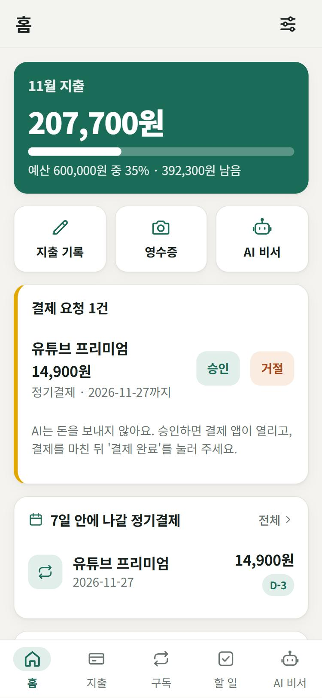
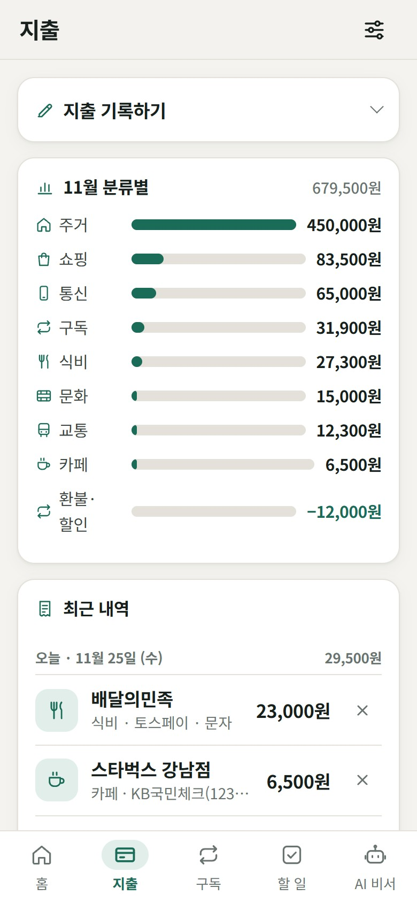
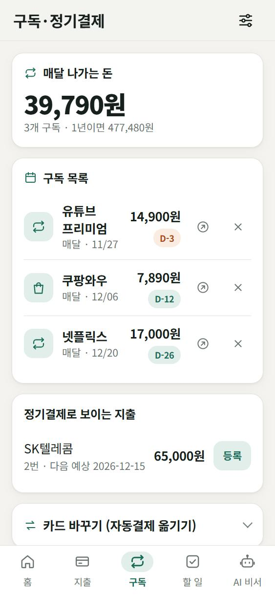
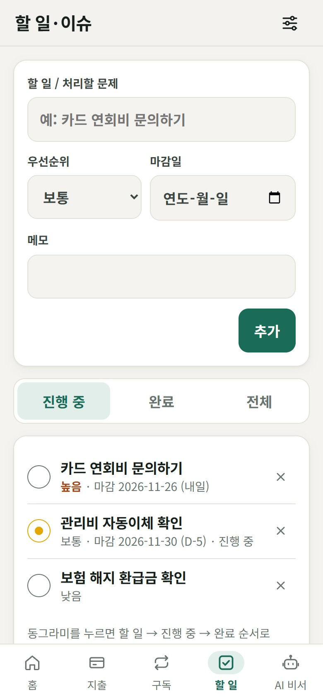
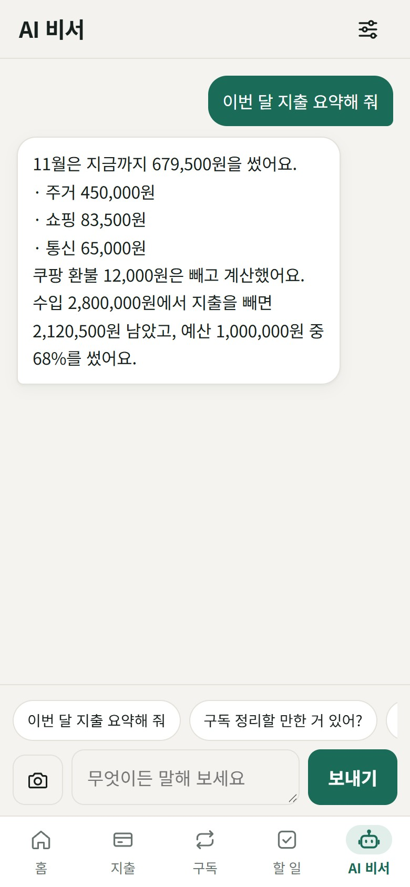

# 포켓매니저: 휴대폰용 결제·할 일 AI 비서

결제 문자와 은행·카드 앱 알림을 읽어 **지출·입금·수입을 자동으로 정리**하고, 구독·할 일·결제 요청까지 AI 비서와 대화로 관리하는 안드로이드 앱입니다. 서버 없이 모든 기록이 휴대폰 안에만 저장됩니다.

| 홈 | 지출 | 구독 | 할 일 | AI 비서 |
|---|---|---|---|---|
|  |  |  |  |  |

> 화면의 금액·가맹점은 모두 예시 데이터입니다.

**▶ 1분 시연 영상:** [design/demo/pocket-manager-demo.mp4](design/demo/pocket-manager-demo.mp4) (컴퓨터용 테스트 화면에서 결제·입금 알림을 보내며 찍었어요. AI 비서 답변은 실제 Gemini 답변이고, 답을 기다리는 시간만 줄였어요)

## 할 수 있는 일

| 기능 | 설명 |
|---|---|
| 지출 기록·분석 | 안드로이드 앱은 결제 문자·알림이 오는 대로 금액·가맹점·카드·날짜·분류를 자동으로 기록해요. 결제 문자를 직접 붙여넣어도 되고, 웹앱(PWA)으로 설치했다면 문자 앱의 '공유 → 포켓매니저'로도 넘길 수 있어요. 월별 합계, 분류별 그래프, 예산 대비 잔액을 보여 줘요. |
| 입출금·수입 | 은행 앱 입출금 알림을 읽어 입금·이체를 따로 기록해요. 월급처럼 번 돈은 '수입으로', 월세처럼 이체로 쓴 돈은 '지출로' 한 번 누르면 같은 사람은 다음부터 자동으로 분류돼요. 홈에서 이번 달 수입과 '수입 − 지출'을 보여 줘요. |
| 환불·해외결제 | 결제 취소·환불·캐시백은 마이너스 지출로 따로 모아요. 해외 결제는 외화로 먼저 추정해 기록하고, 원화 출금 알림이 오면 실제 금액으로 바꿔요. |
| 구독·정기결제 | 구독을 등록하면 D-day를 알려 주고, 결제일이 지나면 다음 달로 넘겨요. 매달 비슷한 금액이 나가는 곳을 찾아 구독 후보로 보여 줘요. |
| 영수증 정리 | 영수증 사진을 찍으면 AI가 읽어서 지출로 기록해요. |
| 할 일·이슈 | 우선순위와 마감일로 정렬하고, 할 일 → 진행 중 → 완료로 관리해요. |
| 카드 바꾸기 | 구독 탭 아래 **카드 바꾸기**에서 기존 카드(예: `신한카드(1234)` 또는 `1234`)와 새 카드를 넣으면, 기존 카드로 매달 나가던 곳을 찾아 할 일 체크리스트로 만들어요. 각 항목에 '변경하러 가기' 링크가 붙고, **새 카드로 그 가맹점 결제 문자가 오면 자동으로 완료** 처리돼요. 토스페이·카카오페이·네이버페이·페이코로 결제된 곳은 간편결제 하나로 묶어서 맨 위에 보여 줘요. 그 앱에서 결제카드를 한 번 바꾸면 연결된 곳이 같이 바뀌니까요. AI 비서에게 "1234 카드 자동결제를 5678로 옮기고 싶어"라고 말해도 돼요. |
| 결제 요청 | AI나 사용자가 '결제 요청'을 만들면 홈에서 **직접 승인**해요. 승인하면 결제 앱(기본: 토스)이 열리고, 결제를 마친 뒤 '결제 완료'를 누르면 지출에 기록돼요. |
| AI 비서 | "이번 달 지출 요약해 줘", "구독 정리할 만한 거 있어?", "내일까지 관리비 내기 할 일로 추가해 줘"처럼 말로 시키면 앱 데이터를 직접 읽고 써요. |

### 결제는 왜 AI가 직접 하지 않나요?
AI가 돈을 직접 보내게 만들면, 잘못 알아들었거나 이상한 문자·영수증에 속았을 때 돈이 그냥 나가 버립니다. 그래서 이 앱의 AI에게는 **송금 기능이 아예 없습니다.** 결제 요청을 만드는 것까지만 하고, 승인과 실제 결제는 항상 사용자가 결제 앱에서 합니다. 카드번호·계좌번호·비밀번호도 저장하지 않습니다.

## 안드로이드 앱으로 설치하기 (결제 문자·알림 자동 기록)

안드로이드 앱(APK)으로 설치하면 **결제 문자와 카드사·토스·카카오페이 알림을 직접 읽어 자동으로 기록**합니다.
- 결제처럼 보이는 문자·알림(금액 + 승인/결제 같은 단어)만 남기고 나머지는 바로 버려요.
- 카카오톡 대화와 문자 앱 알림은 읽지 않아요(문자는 문자 수신 기능으로 따로 받아요).
- 처음 켤 때 지난 90일 결제 문자를 한 번에 가져올 수 있어요.

**APK 만들기 (컴퓨터)** — Java 21과 Android SDK가 필요해요.
```
npm install
npm run android:build
```
만들어진 파일: `android/app/build/outputs/apk/debug/app-debug.apk` → 휴대폰으로 옮겨 설치(출처를 알 수 없는 앱 설치 허용 필요).

**휴대폰에서** 앱을 열면 홈에 '결제 자동 기록 켜기'가 나와요. 문자 읽기 '허용하기', 알림 읽기 '설정 열기' → 목록에서 포켓매니저를 켜면 끝.

> 플레이스토어에는 올리지 않는 개인용 앱이에요. 구글 정책상 문자 읽기 앱은 스토어 등록이 까다롭습니다.

## 컴퓨터에서 휴대폰 화면으로 테스트하기

```
npm run serve
```
브라우저에서 **http://localhost:5173/test** 를 엽니다.

- 왼쪽: 휴대폰 틀 안에서 앱이 실제 휴대폰 크기로 돌아가요. 기기(갤럭시 S24, 픽셀 8, 폴드 등)를 바꿀 수 있어요. 마우스 클릭이 손가락 터치예요.
- 오른쪽: 카드 결제 **문자·알림을 보내는 버튼**, 문자/알림 권한 켜고 끄기, 앱 끄고 켜기, 문자함에 지난 결제 넣기.
- '상황 테스트'로 중복(문자+알림 동시), 연달아 3건, 토스·카카오페이, 결제 취소, 결제 아닌 문자를 바로 시험할 수 있어요.
- 이 테스트 화면(`dev/`)은 앱 설치 파일에는 들어가지 않아요.

**실제 안드로이드로 시험하려면**
- **내 휴대폰을 컴퓨터 화면에 띄우기:** 휴대폰에서 '개발자 옵션 → USB 디버깅'을 켜고 USB로 연결한 뒤, scrcpy 같은 화면 미러링 프로그램을 쓰면 컴퓨터에서 마우스로 실제 앱을 조작할 수 있어요.
- **가상 휴대폰(에뮬레이터):** Android Studio의 에뮬레이터에 APK를 설치해 시험할 수 있어요(CPU 가상화가 켜져 있어야 해요).

## 웹앱으로 쓰기 (선택)

`web` 폴더를 https 주소에 올리면(예: https://app.netlify.com/drop 에 `web` 폴더 끌어다 놓기) 휴대폰 크롬에서 '홈 화면에 추가'로 설치할 수 있어요. 웹앱은 문자를 직접 읽지 못하고, 문자 앱에서 '공유 → 포켓매니저'로 넘겨야 해요.

## AI 비서 켜기

기본 AI는 **Gemini**입니다. 설정(⚙️)에서 Claude로 바꿀 수도 있어요.

**Gemini**
1. https://aistudio.google.com 에 Gemini를 구독 중인 구글 계정으로 로그인 → **Get API key** → 키 만들기
2. 앱 설정 → Gemini API 키에 붙여넣기 → '모델 불러오기'로 모델 고르기(기본: 최신 Flash 자동)

> Gemini 앱 구독(Google AI Pro 등)과 API 사용료는 별개예요. 다만 Gemini API에는 무료 사용량이 있어서 개인 가계부 정도는 대부분 무료로 돼요. **무료 등급에서는 보낸 내용이 구글 서비스 개선에 쓰일 수 있으니**, 민감하다면 AI Studio에서 결제를 연결해 유료 등급으로 쓰세요.

**Claude** — https://console.anthropic.com 에서 키를 만들어 넣어요(사용량만큼 과금, Claude 앱 구독과 별개).

API 키는 휴대폰 안에만 저장되고 고른 AI 회사로만 전송돼요. 백업 파일과 깃 저장소에는 들어가지 않아요.

## 데이터

- 모든 기록은 **이 휴대폰 안에만** 저장됩니다. 서버가 없어요.
- 앱 데이터를 지우면 기록도 지워지니, 설정 → **백업 내보내기** 로 가끔 저장해 두세요.

## 개인 정보 보호

- 지출·입금·구독·할 일 기록은 휴대폰 안에만 저장돼요. 이 앱에는 서버가 없어요.
- 결제와 상관없는 문자·알림은 읽고 바로 버리고, 카카오톡은 은행·카드사 알림톡만 읽어요(대화는 읽지 않아요).
- 카드번호 전체·계좌번호·비밀번호는 저장하지 않아요. AI 도구도 긴 숫자가 들어오면 저장을 거부해요.
- AI에게는 송금 기능이 없어요. 결제는 사용자가 승인한 뒤 결제 앱에서 직접 해요.
- 저장소에는 `.gitignore`와 커밋 전 검사 스크립트(`check-private.mjs`)가 있어서 API 키·서명 키·개인 결제 내역 파일·개인 이메일·전화번호·카드번호가 올라가지 않게 막아요.

## 파일 구성

| 파일 | 역할 |
|---|---|
| `web/index.html`, `web/styles.css` | 화면 |
| `web/app.js` | 탭 화면, 입력, 결제 승인, 카드 바꾸기 |
| `web/store.js` | 데이터 저장·계산(월 합계, 구독 D-day, 반복결제·카드별 자동결제 찾기) |
| `web/sms.js` | 카드 결제 문자·알림 해석(AI 없이 동작) |
| `web/native.js` | 안드로이드 앱에서 문자·알림 자동 기록 |
| `web/agent.js`, `tools.js`, `gemini.js`, `claude.js` | AI 비서(도구 정의, Gemini·Claude 연결) |
| `android/…/PaymentReaderPlugin.java` 외 | 문자 수신·알림 읽기·문자함 가져오기(안드로이드) |
| `serve.mjs` | 컴퓨터에서 미리 보기: `npm run serve` → http://localhost:5173 |
| `check-private.mjs` | 커밋 전 개인 정보 검사 |

## 다음에 할 것

- **Gmail 결제 메일 읽기**: 안드로이드 앱 안에서는 구글 로그인을 앱 방식으로 붙여야 해요(웹 방식 로그인은 앱 안에서 구글이 막아요).
- **결제일 알림**: 휴대폰 알림으로 D-day 알려 주기.
